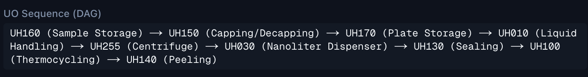
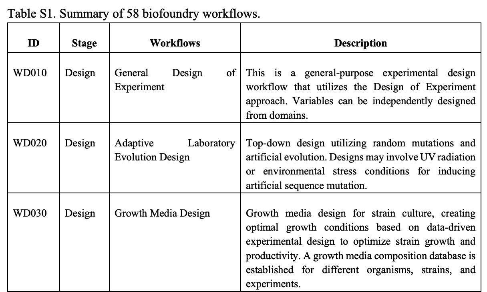
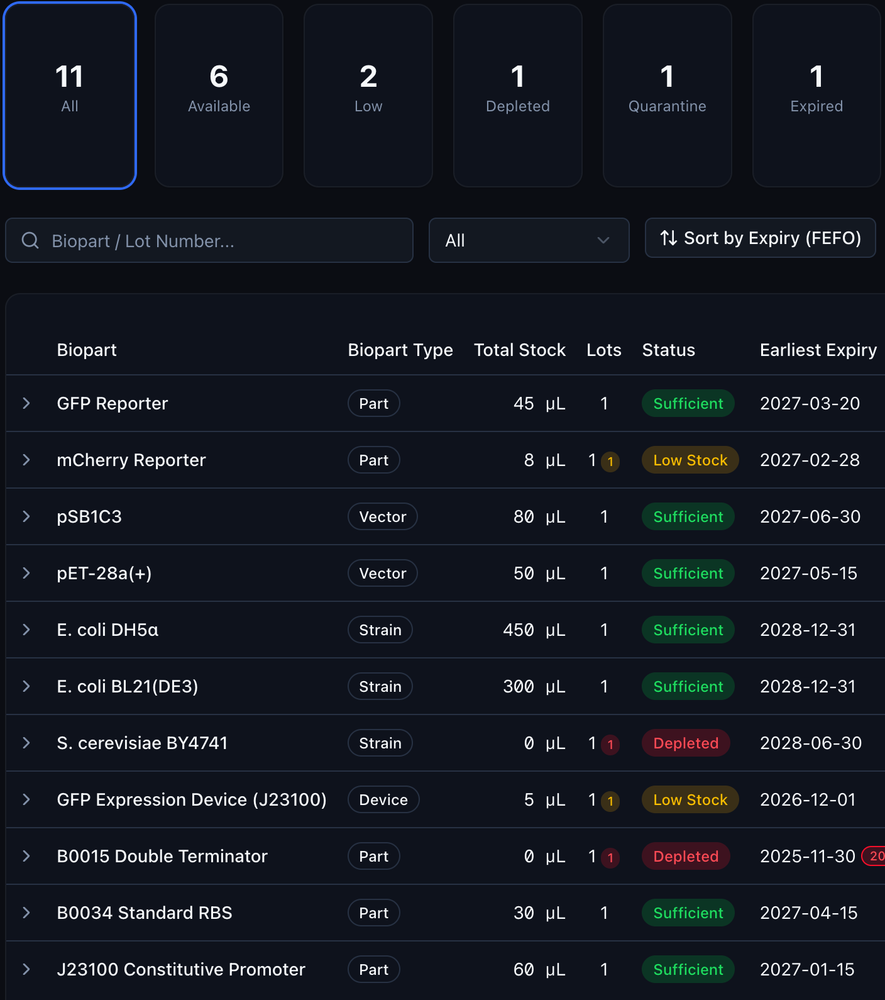

# k-biofoundry-proto2 통합 대시보드 기능 명세서

본 문서는 바이오파운드리 통합 플랫폼 프로토타입(`k-biofoundry-proto2`)의 대시보드 아키텍처와 세부 기능 요건을 합성생물학의 **DBTL (Design-Build-Test-Learn) 사이클** 및 **파운드리 인프라 관리** 관점에서 구조화하여 정리한 명세입니다.

---

## 1. Experiments (실험 및 데이터 관리)
실험의 전 과정을 디지털 자산화하고, 하드웨어 장비 연동 및 AI 최적화를 위한 데이터 기초를 형성하는 모듈입니다.

* **디지털 랩 노트 (Digital Lab Note)**
  * **Input / Output 데이터 매핑:** 실험에 투입된 시료(샘플 ID, 농도, 부피 등)와 최종 확보된 산물(Yield, 순도 등)의 정량적 결과 값을 구조화하여 기록합니다.
  * **메타데이터 및 파라미터 관리:** 실험 수행 날짜, 담당자 정보, 사용 장비 ID와 함께 세부 구동 조건(온도, RPM, 사이클 수, 분주 속도 등)을 연동합니다.
  * **시약 및 재료 추적 (Reagents & Materials):** 사용된 시약의 제조사, Lot 번호, 보관 상태 및 바코드를 매핑하여 실험의 재현성을 보장합니다.
  * **품질 관리 결과 (QC Results):** 흡광도 분석(Nanodrop/Spectrophotometer), 전기영동 젤 이미지, 바코드 시퀀싱 결과 등을 기반으로 합성 및 배양 QC의 합격/불합격(Pass/Fail) 여부를 판정합니다.
* **프로토콜 파일 관리 (Protocol Management)**
  * **다중 포맷 지원:** 연구원의 가독성을 위한 마크다운(`.md`) 및 정식 보고서용 `.pdf` 문서 관리를 지원합니다.
  * **장비 스크립트 번들 (`.bundle`):** 자동화 액체 생물 분주기나 로봇 제어 언어(스크립트 변수 및 환경 설정)를 포함한 번들 파일을 관리하여 수동 프로토콜을 '하드웨어 자동화 프로토콜'로 매끄럽게 전환합니다.
* **Workflow AI**
  * 축적된 실험 노트를 머신러닝 모델로 분석하여, 목적산물의 수율(Yield)을 극대화하거나 실패율을 낮출 수 있는 최적의 시약 조성, 프라이머 농도, 장비 파라미터 변동값 등을 연구원에게 역으로 제안합니다.

---

## 2. Workflow Library (하드웨어 워크플로우 예시)
한국생명공학연구원(KRIBB)의 물리적인 바이오파운드리 하드웨어 인프라를 소프트웨어 상에서 유기적으로 제어하기 위한 표준 레시피 저장소입니다.

* **KRIBB 하드웨어 워크플로우 템플릿**
  * 텍스트 형태의 실험 프로토콜을 자동화 로봇 및 이송 장치가 이해할 수 있는 실질적인 '작업 순서(Hardware Workflow)' 가이드라인으로 변환하여 제공합니다.
  * **예시 파이프라인:** `DNA Assembly`.
  
  * 유저는 KRIBB 장비 세팅에 최적화된 표준 워크플로우 예시를 라이브러리에서 탐색하고 자신의 실험 목적에 맞게 벤치마킹하여 적용할 수 있습니다.

* KRIBB hardware 참고 : https://doi.org/10.1038/s41467-025-61263-6 / Supplementary information Table 1

---

## 3. Design Studio (합성생물학 CAD 및 Bio-AI 엔진)
유전체 설계, 조립 시뮬레이션, 거대 AI 모델을 통한 기능 예측까지 원스톱으로 지원하는 플랫폼의 가장 핵심적인 바이오 CAD(Computer-Aided Design) 생태계입니다.

### 1) 벡터 및 클로닝 설계 (Vector Design)
* **Cloning (클로닝 파이프라인)**
  * 벡터 백본(Vector Backbone), 바이오파츠(Parts), 제한효소(BsaI, BsmBI 등 Type IIS) 자리를 고려한 오버랩 서열 정보를 자동 계산합니다.
  * 프라이머 품질 정밀 검사 기능을 제공합니다.
    * *측정 지표 예시:* GC 함량(41%), 헤어핀 구조 최소 자유에너지($\Delta G = 0.0$ kcal/mol), 자가이합체 결합력($\Delta G = -13.53$ kcal/mol), 3' 말단 이합체 결합력($\Delta G = -2.2$ kcal/mol), 녹는점($T_m = 60.8^\circ	ext{C}$). 이를 통해 클로닝 물리 실험의 실패 요인을 사전에 스크리닝합니다.
* **Combo (다중 파츠 조합 검증)**
  * 대량의 바이오파츠를 조합하여 다양한 후보군(Combinatorial Library)을 생성할 때 발생할 수 있는 규칙 위반 및 오류 로그를 실시간으로 탐지하고 구체적인 조치 방법을 피드백합니다.
  * *주요 검증 규칙:* `ATG` 시작 코돈 누락, 종결(`Stop`) 코돈 누락, RBS-CDS 간격 오류(대장균 기준 최적 거리 5-10 bp 미준수), 유전자 서열이 밀리는 프레임 시프트(Frame shift) 현상 등.
* **AI 최적 조합 추천**
  * 타겟 숙주(Host, 예: *E. coli*)와 실험의 최종 목적을 설정하면 최적의 바이오파츠 조합을 점수화(Scoring)하여 추천합니다.
  * *설정 목적 예시:* 숙주 내 고발현(High expression), 유도성 발현(Inducible expression), 세포 내 대사 부담 최소화(Minimizing metabolic burden), 게놈 내 안정 발현(Stable expression) 등.
* **서열 등록 및 자원 동기화**
  * 로컬 서열 파일(DNA, `.gb`[GenBank], `.fasta`) 업로드를 지원할 뿐만 아니라, NCBI 및 Addgene 생물자원 데이터베이스와 API 연동을 통해 서열을 직접 불러올 수 있습니다.
  * 파츠별 이름, 타입(Promoter, RBS, CDS, Terminator 등), 피쳐(Feature) 색상 라벨링, 서열 세부 설명, 내부 유저 간의 공유 여부 설정을 지원합니다.
* **커뮤니티 (Community Hub)**
  * 플랫폼 내부 연구원 및 유저들이 자체 설계한 맞춤형 벡터, 바이오파츠, 고유 피쳐(Feature) 디자인 세트를 상호 공유하고 리뷰할 수 있는 협업 환경을 제공합니다.

### 2) 특화 디자인 툴킷
* **Primer Design:** 클로닝, qPCR, 시퀀싱용 프라이머 자동 생성 및 스크리닝.
* **Codon Optimization:** 목적 숙주(Host)의 코돈 사용 빈도(Codon Usage Bias)를 고려한 서열 최적화 알고리즘.
* **CRISPR gRNA Design:** Off-target 효과를 최소화하고 절단 효율을 극대화한 가이드 RNA 설계.
* **Parts Circuit Design:** 다중 논리 게이트를 포함한 생물학적 유전자 회로(Genetic Circuit) 토폴로지 설계.
* **Pathway Modeling & DOE Wizard:** 대사 경로(Metabolic Pathway) 모델링 및 다변수 실험 최적화를 위한 실험계획법(Design of Experiments) 마법사 기능.

### 3) Simulation Lab (조립 시뮬레이션)
물리적인 빌드(Build) 실험에 착수하기 전, 수학적 기법과 서열 매칭 데이터를 기반으로 여러 모델의 인비트로(In vitro) DNA 조립 성공 확률을 하이브리드 점수로 계산합니다.
* **Golden Gate Assembly 성공률 계산 모형:**
  successRate = fidelity × digestionEff 
* **Gibson Assembly 성공률 계산 모형:**
  successRate = fidelity × enzymeEff × avgAnnealEff

### 4) Bio AI Models & Assistant
최신 바이오 도메인 특화 인공지능 모델을 웹상에서 즉시 구동하고 자문받을 수 있는 인프라입니다.
* **구조 예측 및 생성 AI:** 단백질 3차원 구조를 예측하는 **AlphaFold2**, **ESMfold**와 단백질 언어 모델 **esm-2**, 새로운 단백질 서열을 백지 상태에서 디자인(De novo design)하는 단백질 역확산 모델 **RFdiffusion** 및 **LigandMPNN** 연동.
* **분자 결합 및 스크리닝 AI:** 분자 간 결합력을 예측하는 **AutoDock Vina** 연동 환경 및 서열 패턴 분석용 **Scanner** 제공.
* **AI Assistant:** 대화형 인터페이스를 통해 복잡한 실험 설계 자문, 오류 로그 분석, 라이브러리 추천을 제공하는 AI 비서 가동.

---

## 4. Station Management (원격 장비 관제)
바이오파운드리 자동화 센터 내부에 배치된 물리적 이기종 장비들의 실시간 연결 상태 및 가동률을 모니터링하는 중앙 관제 센터입니다.

* **장비 정보 및 디지털 트윈 인터페이스:** 파운드리 내 자동화 액체 분주기, 초고속 분석기기(Mass Spec, 플레이트 리더 등)의 고유 사양과 네트워크 상태 관리.
* **실시간 Status 모니터링:** 각 자동화 스테이션의 현재 가동 상태(`Running`, `Idle`, `Error`, `Maintenance`) 및 작업 진척도를 시각화하여 병목 현상을 차단합니다.

---

## 5. Biobank Management (표준 바이오파츠 레포지토리)
합성생물학 및 파운드리 조립 실험에 즉각적으로 투입할 수 있도록 규격화된 생물학적 부품(Standard Biological Parts)의 물리적·디지털 저장소입니다.

* **BioParts DB 동기화:** 현재 프로토타입 기준으로 **15개의 검증된 바이오파츠 데이터**가 등록되어 있으며, 모든 파츠는 `Design Studio`의 클로닝 설계 및 조합 생성기 툴킷과 마우스 클릭 한 번으로 유기적으로 연동됩니다.

---

## 6. Inventory Management (실험실 ERP 및 자원 관리)
연속적인 파운드리 가동과 실험 수행을 뒷받침하기 위한 백오피스 물류 자원 관리 시스템입니다.

* **재고(Stock) 정보 실시간 추적:** 실험실 내 소모품(파이펫 팁 박스, 96/384 웰 플레이트 등)과 유전자 합성 시약의 실시간 잔량을 추적합니다.
* **유효기간 및 공급망 관리:** 시약의 유효기한 만료 사전 알림 시스템, 재고 부족 시 자동 재구매 요청 프로세스 및 구매 이력 관리를 지원합니다.

## 참고할만한 점
- experiments & workflow library : golden, gibson 실험 & 하드웨어 프로토콜
- vector design : 프라이머 품질 로그, 유저 목적에 따른 ai 최적 조합 추천(e.coli 고발현, 유도성 발현, 대사 부담 최소화, 안정 발현, host)
- simulation lab : golden, gibson의 성공률 계산

## 차이점
- vector design에서 golden, gibson을 자동으로 수행해주지 않음 (input : vector backbone, restriction enzyme, parts / output : 적절한 오버행, 프라이머 디자인)
- 파츠 조합 : 오류로그를 자세히 반환해줌(ex. ATG 시작코돈 없음, stop 코돈 없음, rbs-cds간격(최적 5-10), frame shift, 조치방법)
- 파츠 서열 등록 기능 : dna, gb, fasta 타입과 데이터베이스(ncbi, addgene)의 ID 검색 후 등록 기능
- 아직 기능이 완성되지 않았지만 ai 추천 기능이 많이 보임(실험방식 최적화, 목적에 따른 최적 파츠 조합 추천 등)
- 포털 하나로 실험에 필요한 모든 기능을 총 정리한 느낌 : 하드웨어 정보, stock 정보, 실험 프로토콜, 시뮬레이션, bioinformatics tools(esmfold, alphafold,autodock 등)